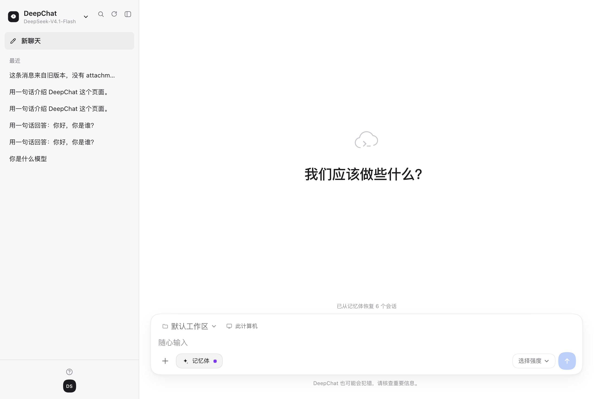
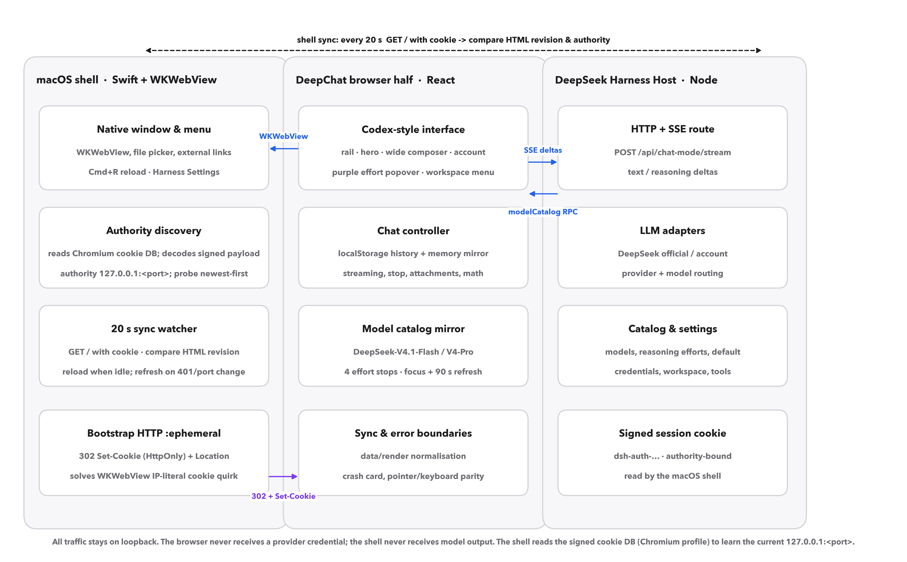

# DeepChat

**Codex-style, local-first chat for DeepSeek Harness — live model catalogue, signed-cookie port discovery, and a drag-based reasoning-effort control.**

[](LICENSE)
[](paper/LICENSE-CC-BY-4.0.md)
[](#quick-start)
[](CHANGELOG.md)
[](paper/DeepChat-Nature-Bilingual-18p.pdf)



DeepChat adds a full-page, Codex-shaped conversation surface to the DeepSeek
Harness Web UI, plus a ~1 MB native macOS shell that makes it feel like an
application. It keeps the conversation local, treats the model menu as a live
view of the host catalogue, and discovers the host's ephemeral loopback port
from the authority inside its signed session cookie. The browser half never
sees a provider key; the native shell never sees model output.

**The 18-page, Nature-style English/Chinese preprint is in
[`paper/DeepChat-Nature-Bilingual-18p.pdf`](paper/DeepChat-Nature-Bilingual-18p.pdf).**
It has 7 figures, 11 tables and 58 verified references; the source, data and
build scripts are in [`paper/`](paper/).

## What is new in 1.3.0

- **Text-to-image modal.** A new picture button in the rail and composer opens a
  six-mode image generator: Auto, Photo, Illustration, Poster, Fast and HD,
  with 1:1 / 3:2 / 2:3 aspect ratios and 1/2/4 images.
- **Two channels.** `Auto` prefers the configured Harness image model and falls
  back to the keyless free online channel; `Harness` uses the registered
  `image_generate` tool; `Free online` calls pollinations.ai directly.
- **Desktop integration.** The native menu has **Generate image…** (⌘⇧I),
  opening the same modal in the app.
- The plugin's Host half adds authenticated image routes; they load after the
  next Harness restart. Until then the page's free channel works immediately.
- Verification is now **143** pipeline checks + 59 formatting checks.

## What was new in 1.2.0

- **Model update, live.** The panel followed the host through a real catalogue
  update from `DeepSeek-V41-Flash` to **`DeepSeek-V4.1-Flash`**, with
  `DeepSeek-V4-Pro` available in both provider groups. No client release was
  needed; the catalogue is read from the host RPC on focus, every 90 s, or on
  demand. New conversations follow the host default.
- **Port update, live.** The host restarted on a new loopback port
  (`127.0.0.1:19387` → `127.0.0.1:53254`). The shell now decodes the
  `authority` from each signed `dsh-auth-…` cookie, probes candidates
  newest-first, and adopts the one that answers `200`. No hard-coded port.
- **Dead click targets fixed.** The model line in the effort popover opens the
  model menu; the lightning button boosts to maximum and back; the memory pill
  toggles with a filled/hollow dot; the account avatar opens an account card
  that reaches Harness settings; the workspace chip opens the host workspace
  list. All eight interactions are covered by the scripted audit.
- **The effort track is now a real gauge.** The selected portion is a purple
  flowing gradient with drifting stars; the unselected portion is white. The
  thumb is the boundary, and the fill follows it.
- **Launch-time regression fixed.** The shell only clicks the Harness sidebar
  entry, so the model menu no longer opens at boot (1.1.1).
- **The paper.** Exactly 18 pages, bilingual, Nature-style, with 58 references.

## Quick start

### Requirements

- macOS 13 or later
- DeepSeek Harness desktop app (local), logged in to a
  DeepSeek account
- Xcode Command Line Tools only if you build the native shell

### 1. Install the Harness plugin

From the repository root, in a DSH session with the plugin manager available:

```text
plugin_manager({ action: 'install_bundle', target: '/absolute/path/to/deepchat/chat-mode' })
```

If you prefer the manual route, link the bundle into the active profile and
restart Harness:

```sh
cd ~/.dsh/profiles/desktop     # or your active profile
pnpm add link:/absolute/path/to/deepchat/chat-mode
```

The bundle's `cordis.patch.yml` inserts the Host row and registers the two
sidebar entries (**Harness** and **DeepChat**). The browser half is hot-swapped
on the next page load; the Host half needs a Harness restart.

### 2. Install the macOS app

Download `DeepChat-1.3.0-macOS.zip` from the
[latest release](https://github.com/zengpu987-ctrl/deepchat/releases/latest),
unzip it into `/Applications`, and open it. Or build from source:

```sh
cd deepchat-app
./build.sh --install
open /Applications/DeepChat.app
```

The app is an ad-hoc-signed, non-sandboxed WKWebView shell. It needs read access
to the local Harness Cookie database to sign in without a token; see
[Security and privacy](#security-and-privacy).

### 3. Use it

- **Model** — click the model name at the top of the rail. The menu is grouped
  by provider; the current route is checked.
- **Effort** — click **Choose effort**; drag the track, press the lightning
  button for maximum, or press the reset glyph for the model default.
- **Workspace** — click the workspace chip to list and switch host workspaces.
- **Memory** — the pill toggles the memory bundle; the small dot shows the state.
- **Account** — the avatar opens the account card and a direct route to Harness
  settings.
- **Image** — the picture button in the rail or composer opens the six-mode
  text-to-image modal. `Auto` prefers a configured Harness image model and falls
  back to the keyless free online channel; images can be downloaded, and the
  Harness channel saves them under `generate/image`.
- **Files** — PDF, images, Mathematica notebooks, text and web pages are parsed
  locally (up to six per message); unsupported binaries are rejected with a
  reason instead of being pasted as mojibake.

## Architecture



DeepChat is two halves plus a shell:

| Layer | Responsibility |
|---|---|
| DeepSeek Harness Host | model routing, provider credentials, sessions, authenticated loopback server |
| Browser half (`chat-mode/client.js`) | Codex-shaped UI, history, attachments, markdown/MathML, effort control |
| Native shell (`deepchat-app/src/main.swift`) | WKWebView window, signed-cookie authority discovery, 302 bootstrap, 20 s sync watcher |

The Host route is `POST /api/chat-mode/stream`, registered on the authenticated
`/api` channel. It streams three SSE event kinds (`text`, `reasoning`, `error`)
and has no settings or filesystem capability. The browser half never receives a
provider credential.

### Synchronisation contract

| Event | Signal | Interval / guard | Action |
|---|---|---|---|
| model added/renamed/removed | catalogue RPC | focus, 90 s, button; skipped while streaming | re-read; keep a routable selection |
| page/bundle updated | served HTML revision | 20 s; idle only | reload from origin |
| host restarted on a new port | cookie authority + 401/refused | every probe; newest-first | rediscover, adopt, reload |
| cookie rotated | signed payload | each sync tick | clear WebKit cookies, re-bootstrap |

The only state that reloads is *idle*: no streaming answer, an empty composer and
no pending attachment. A draft stalls the reload until the next tick.

## Verification

```sh
node tools/chat-mode-check.mjs          # 143 pipeline checks
node tools/chat-mode-format-check.mjs   # 59 formatting/decoding checks
```

Both suites use the real Host and browser halves against stubs; both pass on
1.3.0. The live scripted audit adds 80 trials across eight interactions, and the
auth check is 200 with the 53254 cookie and 401 without it. See Table 4 and
Extended Data in the paper.

The paper is generated from the same data:

```sh
cd paper
python3 build_paper.py
node render_pdf.mjs
```

The PDF is exactly 18 A4 pages. See [`paper/README.md`](paper/README.md) for the
full rebuild and measurement instructions.

## Repository layout

| Path | Contents |
|---|---|
| `chat-mode/` | Cordis/React client bundle, Host route, locales, icon, bundle manifest |
| `deepchat-app/` | Swift/WKWebView shell, assets, Info.plist, build script, icon generator |
| `tools/` | 143-check pipeline suite, 59-check formatting suite and the offline loader |
| `paper/` | 18-page PDF, HTML/template source, data, figures, build scripts |
| `docs/` | GitHub Pages landing page, screenshots, paper copy |

## Security and privacy

- Provider credentials stay on the Host. The page receives a model identifier,
  not a key.
- The session cookie is signed, authority-bound and `HttpOnly`; the page cannot
  read it. The shell reads the local Chromium cookie database, decodes only the
  `authority` and issue time, and never logs the value.
- All traffic stays on loopback. Unauthenticated requests return 401.
- No telemetry, analytics or remote logging is included.
- Pasted files can still reach the model; prompt injection is a model-level risk,
  not solved by the shell. See Table 6 and Extended Data Table 2 for the residual
  risks.
- The app is not sandboxed because it needs the Harness cookie database. Do not
  distribute a build to someone who is not comfortable with that access.

## Paper

- **PDF:** [`paper/DeepChat-Nature-Bilingual-18p.pdf`](paper/DeepChat-Nature-Bilingual-18p.pdf)
- **HTML/Pages:** [zengpu987-ctrl.github.io/deepchat](https://zengpu987-ctrl.github.io/deepchat/)
- **Source:** [`paper/template.html`](paper/template.html), 58 references in
  [`paper/data/references.json`](paper/data/references.json)
- **Length:** 18 pages; English pp. 1–10, 中文 pp. 11–14, Extended Data pp. 15–16,
  references/back matter pp. 17–18.

The paper is a preprint and is not peer reviewed. Code is MIT; the paper,
figures and tables are CC BY 4.0.

## Citation

```bibtex
@software{deepchat2026,
  author  = {Zeng, Pu},
  title   = {DeepChat: a local-first, model-synchronising macOS client for
             reasoning-effort-controlled conversational AI},
  year    = {2026},
  version = {1.3.0},
  url     = {https://github.com/zengpu987-ctrl/deepchat},
  note    = {Preprint: paper/DeepChat-Nature-Bilingual-18p.pdf}
}
```

## 中文简介

DeepChat 是 DeepSeek Harness 的一个 Codex 形状全页对话面板，外加一个约 1 MB 的
macOS 原生外壳。它把模型目录当成 Host 的实时视图：新增、改名或更新模型不需要改
客户端；Host 重启换端口时，外壳从签名 Cookie 里的 `authority` 自动发现新端口，而不是
把 19387 写死。思考强度是可拖动的紫色强度条，已选段流光、未选段白色；模型行、闪电、
记忆体、账号、工作区等控件全部可点。

**1.3.0 的主要更新**：新增 **文生图模态**（自动 / 写实 / 插画 / 海报 / 快速 / 高清六种模式，
1:1 / 3:2 / 2:3 画幅，1/2/4 张），可在 Harness 生图与免费在线通道之间选择；桌面菜单
「生成图片…」（⌘⇧I）直接打开。宿主半新增两条已鉴权图片路由，重启 Harness 后加载；
重启前免费通道即时可用。

**1.2.0 的更新**：自动发现新端口（19387 → 53254），跟随 Host 把模型从
`DeepSeek-V41-Flash` 更新到 `DeepSeek-V4.1-Flash`（并提供 `DeepSeek-V4-Pro`），
修复全部点击目标，发布 18 页中英双语、Nature 格式论文（7 图、11 表、58 篇参考文献）。

安装：用 `plugin_manager` 安装 `chat-mode` bundle；从 Release 下载
`DeepChat-1.3.0-macOS.zip` 解压到 `/Applications`。详见上文 Quick start。

## Licence

- Code, build scripts and the native shell: [MIT](LICENSE)
- Paper, figures and data tables: [CC BY 4.0](paper/LICENSE-CC-BY-4.0.md)

DeepSeek and the whale mark belong to DeepSeek. This project is independent and
not endorsed by DeepSeek.
